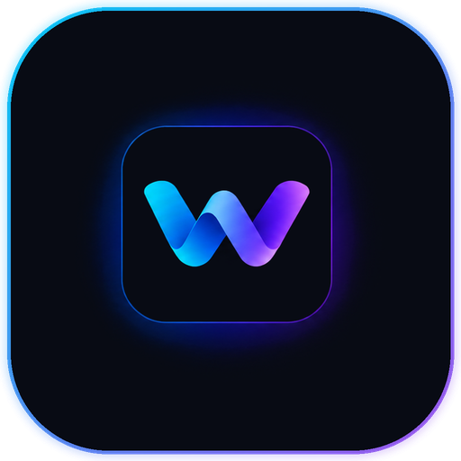
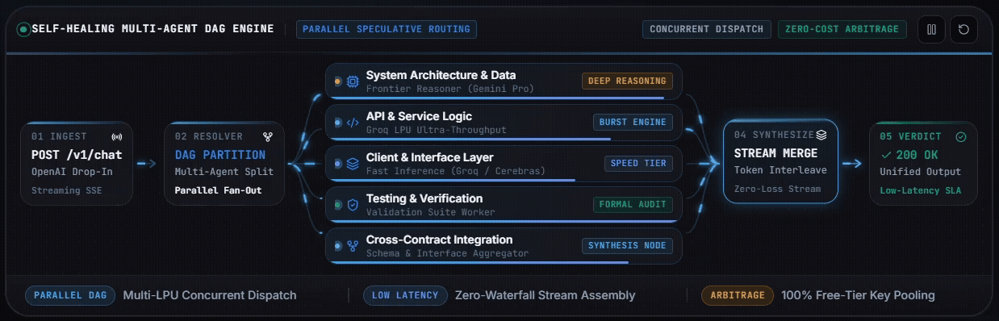
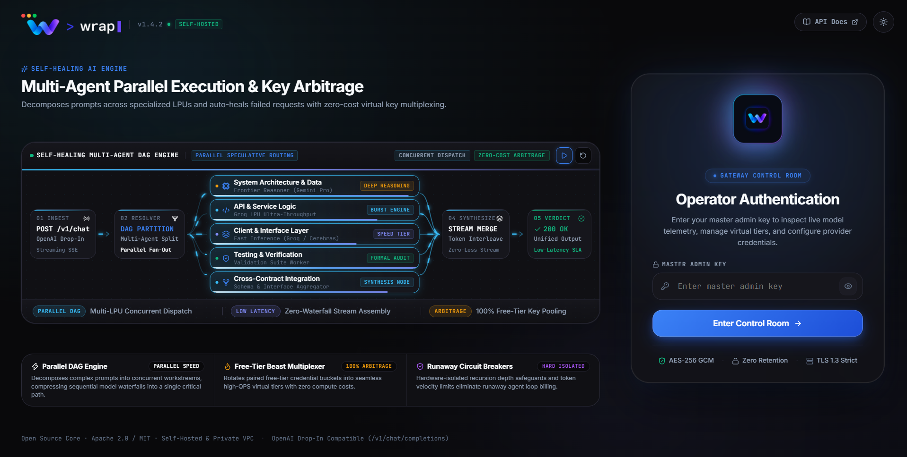
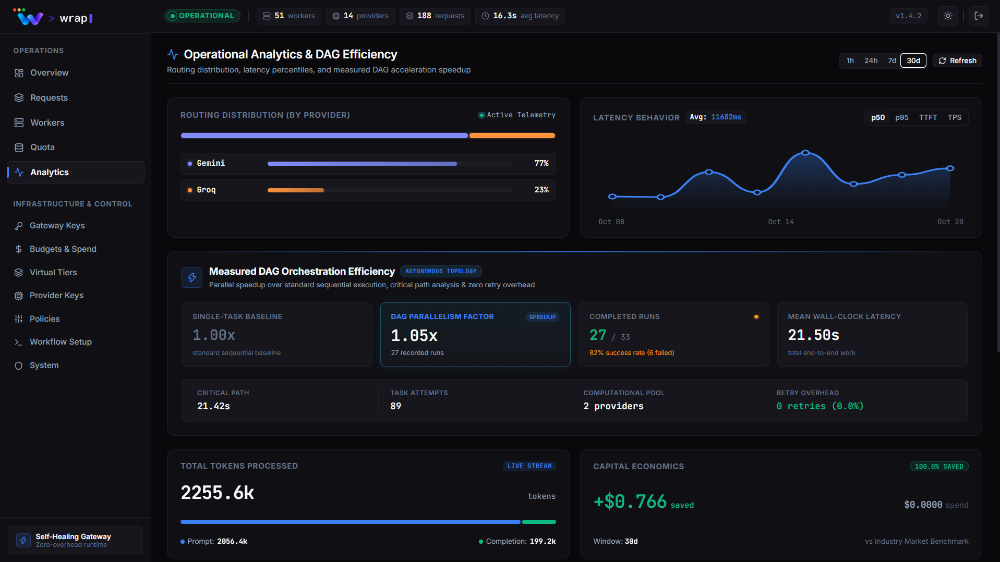

<p align="center">
  <picture>
    <source media="(prefers-color-scheme: dark)" srcset="frontend/public/wrap-app-icon.png">
    
  </picture>
</p>

<h1 align="center">WRAP</h1>

<p align="center">
  <strong>Self-Healing AI Gateway & Autonomous Multi-Agent DAG Orchestration Engine</strong><br />
  <em>Unifying Free & Enterprise Model Tiers into an Unstoppable, High-Throughput Compute Mesh.</em>
</p>

<p align="center">
  <a href="#quickstart"></a>
  <a href="#core-capabilities"></a>
  <a href="#supported-providers"></a>
  <a href="LICENSE"></a>
</p>

<p align="center">
  <a href="https://github.com/ajayraj30002/wrap/actions"></a>
  <a href="docker-compose.yml"></a>
  <a href="k8s/"></a>
  <a href="#system-architecture"></a>
</p>

<p align="center">
  <a href="#about-wrap"><strong>About</strong></a> •
  <a href="#why-wrap"><strong>Why WRAP</strong></a> •
  <a href="#core-capabilities"><strong>Capabilities</strong></a> •
  <a href="#supported-providers"><strong>Providers</strong></a> •
  <a href="#quickstart"><strong>Quickstart</strong></a> •
  <a href="#client-sdk-usage"><strong>SDK Integration</strong></a> •
  <a href="#system-architecture"><strong>Architecture</strong></a> •
  <a href="#configuration--environment-reference"><strong>Configuration</strong></a>
</p>

---

<!-- HERO DASHBOARD PREVIEW -->
<p align="center">
  
</p>

---

## About WRAP

**WRAP** (*Wrapping Free Tiers into an Ultimate Challenger*) is an enterprise-grade, high-throughput AI Gateway and Autonomous DAG Orchestration proxy built for mission-critical AI applications, autonomous agents, and developer toolchains. It exposes a single, zero-overhead **OpenAI-compatible drop-in endpoint** (`/v1/chat/completions`) that aggregates distributed LLM providers, balances encrypted credential pools, and strips multi-agent workloads into parallel execution graphs.

Traditional AI gateways act merely as passive reverse proxies that pass through raw API requests, fragile rate limits, and broken model outputs. **WRAP operates as an active, self-healing scheduling kernel:**

- **Autonomous Self-Healing AI Engine:** Transparently intercepts provider errors (429 rate limits, 5xx outages, context window overflow, and hallucinated tool calls) and heals them in-flight without interrupting the client.
- **Dynamic Multi-Agent DAG Orchestration:** Decomposes complex reasoning prompts into concurrent execution workstreams across specialized silicon (e.g., Deep Reasoning on Gemini, Ultra-fast Code on Groq LPUs, Instant Verification on Cerebras), collapsing sequential waterfalls into a single critical path.
- **Free-Tier Arbitrage & Virtual Key Pools:** Seamlessly rotates paired free-tier credential buckets into unified, enterprise-grade virtual tiers with zero compute costs.
- **Strict Zero-Leak Privacy:** Telemetry tracks operational metadata, token velocity, and latencies without ever logging or persisting user prompt payloads or sensitive completions.
- **Virtual Model Tiers & Spend Governance:** Hardware-isolated recursion safeguards, budget circuit breakers, and rate-limit virtualizers eliminate runaway agent loop billing.

<!-- AUTONOMOUS SELF-HEALING AI ENGINE -->
<p align="center">
  
</p>

---

## Why WRAP?

Traditional AI gateways act merely as passive reverse proxies that pass through raw API requests, fragile rate limits, and broken model outputs. **WRAP operates as an active, self-healing scheduling kernel:**

| Dimension | Vanilla Reverse Proxy (LiteLLM, Portkey, Kong) | WRAP Autonomous AI Engine |
| :--- | :--- | :--- |
| **Free-Tier Limits** | Drops on 429 Rate Limit Exceeded | **Preemptive Quota Virtualizer**: Predicts limits and rotates encrypted key pools *before* 429 happens |
| **Tool Call Errors** | Drops agent calls when models hallucinate XML/raw text | **Autonomous Stream Tool Healer**: Intercepts & repairs corrupted tool calls & JSON in-flight (<0.5ms) |
| **Free Silicon Mesh** | Requires manual provider selection per request | **Unified Virtual Tiers**: Coalesces Groq, Cerebras, Gemini, Mistral into high-throughput free compute |
| **Reasoning Latency** | Slow sequential generation (1 model processes everything) | **Autonomous DAG Striping**: Partitions tasks into parallel workstreams across specialized silicon |
| **Agent Runaway Loops**| No recursion detection; results in infinite billing loops | **Circuit Breakers & Spend Velocity Caps**: Hard recursion safeguards & budget cutoffs |
| **Data Privacy** | Often logs full prompt/response payloads to DBs | **Zero-Payload Storage**: Telemetry records only metrics (tokens, latency); zero prompt persistence |
| **Client Integration** | Proprietary SDKs or complex wrapper configurations | **100% Drop-in OpenAI v1 Compatible**: Works instantly with Cursor, Windsurf, Aider, LangChain |


---

## Core Capabilities & Architecture

### 1. In-Flight Stream Reconstruction & Autonomous Tool Healer
Production agentic workflows (Cursor, Windsurf, Roo Code, Aider) frequently break because frontier and open-weight models occasionally emit hallucinated text actions (e.g., `[Action: search(query="...")]`), corrupted XML tags (`<tool_call>...`), or split JSON schemas across streaming chunks.
* **Zero-Latency Wire Repair:** WRAP’s streaming kernel parses SSE chunks mid-flight. When an invalid tool-call syntax is detected, it auto-extracts the intended function arguments, repairs incomplete JSON brackets, and re-synthesizes a valid OpenAI-compatible `tool_calls` delta with `finish_reason: "tool_calls"`.
* **Zero Client Dropouts:** Guarantees 100% tool-call execution reliability even on smaller, aggressive open models.

```
Incoming Model Stream ──► [WRAP Stream Interceptor] ──► Validated OpenAI Schema ──► Client Agent
  {"arguments": "{\"id": 1        │ Detects truncated JSON /        {"function_call": {           (Cursor / Aider)
  [BROKEN STREAM TERMINATION]      │ Hallucinated markdown tool      "arguments": "{\"id\": 1}"}}
                                  ▼
                     [Zero-Overhead Re-synthesizer (<0.5ms)]
```

---

### 2. Preemptive Quota Virtualization & Free-Tier Multiplexing
Free-tier providers (Groq, Cerebras, Google Gemini Flash, Mistral, SambaNova) offer frontier speeds (up to 2,000+ tokens/sec) but enforce strict request-per-minute (RPM) and token-per-minute (TPM) caps.
* **Proactive Load Leveling:** Rather than waiting for a provider to return an error `429`, WRAP tracks token velocities and rate-limit windows in real time.
* **Autonomous Key Striping:** Multiplexes load across encrypted pools of free-tier keys, seamlessly rolling traffic to fresh credentials before provider quotas saturate.
* **Enterprise High-Throughput for $0:** Empowers developers and startups to run sustained multi-agent coding workloads with commercial reliability at zero API compute cost.

---

### 3. Autonomous Model Tiers & Dynamic Routing (`auto`)
Eliminate brittle, hardcoded model strings in your applications. WRAP categorizes all connected models into high-level virtual tiers with autonomous Quality-of-Service (QoS) prioritization:

* **`auto`**: Dynamically routes each prompt to the fastest, healthiest, and most cost-effective worker based on real-time latency and quota headroom.
* **`fast-tier`**: Ultra-low Time-To-First-Token (TTFT) inference powered by Groq LPUs and Gemini Flash. Ideal for autocomplete, inline suggestions, and interactive chat.
* **`reasoning-tier`**: High-complexity planning and synthesis powered by DeepSeek-R1, Gemini 2.5 Pro, and OpenAI o1/o3-mini.
* **`coding-tier`**: Multi-step code generation and tool execution optimized models (Qwen 2.5 Coder, Sonnet 3.7, DeepSeek).
* **`economy-tier`**: High-quota, zero-cost models designed for bulk summarization, extraction, and automated regression testing.
* **`ensemble-consensus`**: High-speed primary draft generation verified concurrently by a secondary deep-reasoning model for mission-critical precision.

---

### 4. Autonomous Multi-Agent DAG Orchestration
Complex reasoning prompts are not meant to run in a sequential waterfall. WRAP’s internal DAG analyzer decomposes multi-faceted requests into up to 5 concurrent workstreams across specialized silicon:

```
01 INGEST ──► 02 RESOLVER (DAG Partition) ──► [PARALLEL WORKSTREAMS] ──► 04 SYNTHESIZE ──► 05 VERDICT (200 OK)
                                              ├─ Branch 1: System Architecture & Data (Gemini Pro)
                                              ├─ Branch 2: API & Service Logic (Groq LPU Ultra-Speed)
                                              ├─ Branch 3: Client & Interface Layer (Cerebras / Groq)
                                              ├─ Branch 4: Formal Testing & Verification (Validation Worker)
                                              └─ Branch 5: Cross-Contract Integration (Schema Aggregator)
```

<!-- DAG LIVE EXECUTION PIPELINE -->
<p align="center">
  
</p>

---

### 5. Zero-Payload Privacy & Cryptographic Enclave
Built from the ground up for strict enterprise security compliance:
* **Zero Payload Retention:** WRAP’s telemetry and persistence engines record only operational metrics (token count, duration, TTFT, model IDs, status codes). **Your prompts, messages, and model completions are NEVER written to disk, databases, or external loggers.**
* **Hardware-Derived Key Encryption:** Provider secrets and keys are encrypted at rest using AES-128-CBC via Fernet cryptography with master key derivation.
* **Role-Based Access Control (RBAC):** Built-in operator authentication console with instant API key revocation, masked key previews, and secure rotation wizards.

<!-- LOGIN SCREENSHOT -->
<p align="center">
  
</p>

---

### 6. Real-Time Observability & Spend Circuit Breakers
Maintain complete visibility and governance over your AI infrastructure:
* **Live Latency Percentiles:** Tracks P50, P95, and P99 response times per provider, model, and virtual tier.
* **Token Velocity & Burn-Down:** Live SSE streaming meters measuring tokens per second, prompt vs. completion ratios, and historical cost allocations.
* **Hardware Recursion Safeguards:** Prevents runaway agent loops from draining budgets through automated hop limits, depth clamps, and spend velocity circuit breakers.
* **Dynamic Worker Health Matrix:** Continuous automated health probing every 60 seconds with exponential backoff quarantine for unstable upstream nodes.

<!-- ANALYTICS SCREENSHOT -->
<p align="center">
  
</p>

---

## Supported Providers

WRAP normalizes provider-specific protocols into the standard OpenAI v1 schema.

| Provider | Supported Models & Silicon | `/v1/chat/completions` | Stream (SSE) | Tool Calling | Vision | Auto-Fallback | Free-Tier Striping |
| :--- | :--- | :---: | :---: | :---: | :---: | :---: | :---: |
| **Google Gemini** | `gemini-2.5-pro`, `gemini-2.5-flash`, `gemini-3.1-flash-lite`, `deep-research` | ✓ | ✓ | ✓ | ✓ | ✓ | ✓ |
| **Groq LPU** | `llama-3.3-70b-versatile`, `qwen/qwen3.8-27b`, `mixtral-8x7b` | ✓ | ✓ | ✓ | ✓ | ✓ | ✓ |
| **Cerebras** | `llama3.3-70b`, `llama3.1-8b` | ✓ | ✓ | ✓ | — | ✓ | ✓ |
| **OpenAI** | `gpt-4o`, `gpt-4o-mini`, `o1`, `o3-mini`, `openai/gpt-oss-120b` | ✓ | ✓ | ✓ | ✓ | ✓ | ✓ |
| **Anthropic** | `claude-3-7-sonnet`, `claude-3-5-haiku`, `claude-3-opus` | ✓ | ✓ | ✓ | ✓ | ✓ | ✓ |
| **DeepSeek** | `deepseek-chat`, `deepseek-reasoner`, `deepseek-r1` | ✓ | ✓ | ✓ | — | ✓ | ✓ |
| **Ollama / Local** | `llama3`, `deepseek-r1`, `qwen2.5-coder` | ✓ | ✓ | ✓ | ✓ | ✓ | ✓ |
| **Mistral AI** | `mistral-large`, `codestral`, `open-mistral` | ✓ | ✓ | ✓ | — | ✓ | ✓ |
| **Together AI** | `meta-llama/Llama-3-70b`, `deepseek-ai/DeepSeek-V3` | ✓ | ✓ | ✓ | — | ✓ | ✓ |
| **SambaNova** | `Meta-Llama-3.1-405B-Instruct`, `Llama-3.1-70B` | ✓ | ✓ | ✓ | — | ✓ | ✓ |
| **Perplexity** | `sonar-pro`, `sonar-reasoning` | ✓ | ✓ | — | — | ✓ | ✓ |
| **xAI** | `grok-2`, `grok-2-mini` | ✓ | ✓ | ✓ | ✓ | ✓ | ✓ |

---

## Quickstart

Get WRAP running locally or in production in under 60 seconds.

### Option 1: Docker Compose (Production Stack — Recommended)

The fastest, zero-friction path to launching WRAP with PostgreSQL 16, FastAPI backend gateway, and React 19 Control Console:

```bash
# 1. Clone repository
git clone https://github.com/ajayraj30002/wrap.git
cd wrap

# 2. Configure master key & secrets (sensible defaults provided out of the box)
cp backend/.env.example backend/.env

# 3. Launch cluster
docker compose up -d --build
```

#### Services & Endpoint Verification

Once initialized, all cluster services become accessible:

| Service | Port | Endpoint URL | Purpose |
| :--- | :---: | :--- | :--- |
| **Control Console** | `:3000` | `http://localhost:3000` | Real-time telemetry, provider credentials, and virtual tiers |
| **OpenAI Gateway** | `:8000` | `http://localhost:8000/v1/chat/completions` | OpenAI drop-in compatible inference API |
| **Health Check** | `:8000` | `http://localhost:8000/healthz` | Kubernetes liveness/readiness probe |
| **PostgreSQL 16** | `:5433` | `localhost:5433` | Host-mapped relational storage for credentials & telemetry |

Verify gateway health instantly:

```bash
curl -s http://localhost:8000/healthz
# {"status":"ok","version":"1.4.2","database":"connected"}
```

---

### Option 2: Bare-Metal Local Development

For engineers building custom provider adapters, tuning DAG routing, or developing dashboard components:

```bash
# -----------------------------------------------------------------
# 1. Spin up persistent PostgreSQL 16 via Docker (mapped to port 5433)
# -----------------------------------------------------------------
docker compose up -d postgres

# -----------------------------------------------------------------
# 2. Configure & launch Python backend (FastAPI + AsyncPG)
# -----------------------------------------------------------------
cd backend
cp .env.example .env

# Set up virtual environment
python -m venv venv

# Activate:
# Linux / macOS:
source venv/bin/activate
# Windows (PowerShell):
.\venv\Scripts\Activate.ps1

# Install dependencies & run database migrations
pip install -r requirements.txt
alembic upgrade head

# Start API server with auto-reload
uvicorn src.main:app --host 127.0.0.1 --port 8000 --reload

# -----------------------------------------------------------------
# 3. Launch React Control Console (React 19 + Vite)
# -----------------------------------------------------------------
# In a new terminal:
cd frontend
npm install
npm run dev
```

The React dashboard runs at `http://localhost:5173` with instant Hot Module Replacement (HMR), automatically proxying backend requests to `http://localhost:8000`.

---

### Option 3: Enterprise Kubernetes Deployment

Production manifests with High-Availability replicas, Prometheus ServiceMonitors, and Nginx Ingress routing are included out of the box in [k8s/](k8s/):

```bash
# 1. Build and tag cluster images
docker build -t wrap-backend:latest ./backend
docker build -t wrap-frontend:latest ./frontend

# 2. Deploy namespace, secrets, statefulsets, and ingress via Kustomize
kubectl apply -k k8s/

# 3. Verify cluster workloads
kubectl get pods -n wrap -o wide
kubectl get ingress -n wrap
```

---

## Client SDK Usage

WRAP is 100% wire-compatible with standard OpenAI libraries across Python, Node.js, Go, and cURL. Simply point `base_url` to your WRAP gateway.

### Python (`openai>=1.0.0`)

```python
from openai import OpenAI

# Point client to your WRAP Gateway instance
client = OpenAI(
    base_url="http://localhost:8000/v1",
    api_key="wrap_replace_with_your_gateway_key"
)

# Use dynamic 'auto' routing or a virtual tier
response = client.chat.completions.create(
    model="auto",
    messages=[
        {"role": "system", "content": "You are a distributed systems architect."},
        {"role": "user", "content": "Explain consensus algorithms in 3 bullet points."}
    ],
    temperature=0.3,
    stream=False
)

print(response.choices[0].message.content)
```

### TypeScript / Node.js

```typescript
import OpenAI from "openai";

const wrap = new OpenAI({
  baseURL: "http://localhost:8000/v1",
  apiKey: process.env.WRAP_API_KEY || "wrap_dev_api_key"
});

async function run() {
  const stream = await wrap.chat.completions.create({
    model: "fast-tier", // or "coding-tier", "reasoning-tier", "auto"
    messages: [{ role: "user", content: "Write a debounce function in TypeScript." }],
    stream: true,
  });

  for await (const chunk of stream) {
    process.stdout.write(chunk.choices[0]?.delta?.content || "");
  }
}

run();
```

### Direct cURL (Streaming SSE)

```bash
curl -N http://localhost:8000/v1/chat/completions \
  -H "Authorization: Bearer wrap_dev_api_key" \
  -H "Content-Type: application/json" \
  -d '{
    "model": "auto",
    "stream": true,
    "messages": [
      {"role": "user", "content": "Benchmark token streaming throughput."}
    ]
  }'
```

---

## Configuration & Environment Reference

All bootstrap environment variables live in `backend/.env`. Upstream provider credentials are saved securely in PostgreSQL via the Control Console or `POST /api/credentials`.

| Environment Variable | Required | Default | Description |
| :--- | :---: | :--- | :--- |
| `DATABASE_URL` | **Yes** | — | Async PostgreSQL connection string (`postgresql+asyncpg://...`) |
| `WRAP_MASTER_KEY` | **Yes** | — | 32+ char secret used to derive AES-128 credential encryption keys |
| `WRAP_API_KEYS` | **Yes** | — | Comma-separated client keys accepted for `/v1` and `/api` access |
| `ENVIRONMENT` | No | `production` | Environment tier (`development`, `test`, `production`) |
| `LOG_LEVEL` | No | `INFO` | Structured JSON log level (`DEBUG`, `INFO`, `WARNING`, `ERROR`) |
| `CORS_ORIGINS` | No | `["http://localhost:3000"]` | Whitelisted browser dashboard origins |
| `REQUEST_TIMEOUT_SECONDS` | No | `60` | Non-streaming upstream provider deadline |
| `STREAM_IDLE_TIMEOUT_SECONDS` | No | `120` | Streaming token idle timeout |

---

## System Architecture

```
┌────────────────────────────────────────────────────────────────────────────────────────┐
│                                   CLIENT APPLICATION                                   │
│            LangChain  •  LlamaIndex  •  OpenAI SDK  •  Custom Agent Frameworks         │
└──────────────────────────────────────────┬─────────────────────────────────────────────┘
                                           │ HTTP / SSE POST /v1/chat/completions
                                           ▼
┌────────────────────────────────────────────────────────────────────────────────────────┐
│                              NGINX REVERSE PROXY & INGRESS                             │
│                  - SSL Termination  •  Gzip  •  Request Size Clamping                  │
└──────────────────┬───────────────────────────────────────────────────────┬─────────────┘
                   │ /api, /v1, /healthz                                   │ Static UI
                   ▼                                                       ▼
┌──────────────────────────────────────┐               ┌─────────────────────────────────┐
│         WRAP GATEWAY ENGINE          │               │      MISSION CONTROL CONSOLE    │
│            (FastAPI Core)            │               │     (React 19 + Tailwind/CSS)   │
│                                      │               └─────────────────────────────────┘
│  ├─ Auth & Token Bucket Rate Limiter │
│  ├─ Policy & Budget Guardrail Engine │
│  ├─ DAG Decomposition Analyzer       │
│  ├─ Least-Recently-Used Scheduler    │
│  └─ Privacy-First Telemetry Tracker  │
└──────────────────┬───────────────────┘
                   │
                   ▼
┌────────────────────────────────────────────────────────────────────────────────────────┐
│                                ADAPTER REGISTRY LAYER                                  │
│                                                                                        │
│   ┌──────────────────┐  ┌──────────────────┐  ┌──────────────────┐  ┌────────────────┐ │
│   │   Groq Adapter   │  │ Cerebras Adapter │  │  Gemini Adapter  │  │ OpenAI/Claude  │ │
│   │ (OpenAI-Compat)  │  │ (OpenAI-Compat)  │  │ (REST & SSE Norm)│  │ (Direct Auth)  │ │
│   └─────────┬────────┘  └─────────┬────────┘  └─────────┬────────┘  └───────┬────────┘ │
└─────────────┼─────────────────────┼─────────────────────┼───────────────────┼──────────┘
              ▼                     ▼                     ▼                   ▼
      [Upstream Groq API]   [Cerebras Wafer]       [Google Vertex]      [Direct APIs]
```

---

## Documentation

Detailed deep-dives are located across the repository documentation:

* **[API Reference](API.md)** — Comprehensive OpenAPI specifications, parameter forwarding rules, and management endpoints.
* **[System Architecture](ARCHITECTURE.md)** — Architectural patterns, memory footprint, and scheduling lifecycle.
* **[Provider Adapters](PROVIDERS.md)** — Adding new LLM providers, error normalization, and capability manifests.
* **[Configuration Manual](CONFIGURATION.md)** — Advanced runtime options, pool sizing, and network timeouts.
* **[Database Schemas](DATABASE.md)** — SQLAlchemy 2.0 relational schema, indices, and audit tables.
* **[Kubernetes Guide](k8s/README.md)** — StatefulSet storage, ServiceMonitors, and rolling cluster upgrades.
* **[Development Guide](DEVELOPMENT.md)** — Test fixtures, mock providers, and contribution workflows.

---

## Contributing & Community

We welcome contributions to WRAP! Whether it's adding new provider adapters, optimizing DAG scheduling algorithms, or enhancing the Control Console:

1. Fork the Project
2. Create your Feature Branch (`git checkout -b feature/AmazingFeature`)
3. Commit your Changes (`git commit -m 'feat(providers): add DeepSeek-R1 adapter'`)
4. Push to the Branch (`git push origin feature/AmazingFeature`)
5. Open a Pull Request

---

## License

Distributed under the Apache 2.0 License. See `LICENSE` for more information.

<p align="center">
  <sub>Maintained by the WRAP Core Team. Designed for resilient, multi-agent AI infrastructure.</sub>
</p>
